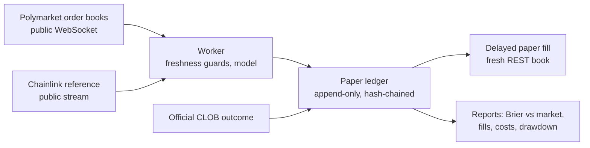

# Vivameda prediction markets

Research on short-horizon Polymarket crypto markets (BTC, ETH and SOL Up/Down, 5 and 15 minutes) and on company-linked prediction contracts. Every study is preregistered, pinned by hash, run on paper, and published with its failures.

Installed services trade on paper only. No result in this repository is a claim of a profitable edge.

## Running now

Status as of 17 October 2026.

| Lane | What it tests | Status |
|---|---|---|
| [Final-minute partial TWAP v3](crypto5m-final60-v3/) | Inside the last 60 seconds part of the settlement TWAP is already fixed. Does the market underprice that? | Candidate passed 16 Oct. Installed. Collecting the first 100 reconstruction checks. |
| [crypto5m v5](crypto5m-v5/) | Baseline forecast over the whole 5-minute window, BTC, ETH and SOL | Candidate passed 16 Oct. Installed. 48-hour review against v2. |
| [crypto5m v2](crypto5m-v2/) | Earlier baseline | Running until the v5 review decides its retirement. |
| [BTC five-minute lab](btc5m/) | BTC paper lab with numeric challengers | Preregistered study 14 to 28 October. |
| Company-contract scanner (repository root) | Polymarket and Kalshi contracts linked to companies | Running, hourly notifications. |

## What we have learned so far

**Engineering.** The v3 candidate ran 30 to 43 seconds behind the market. An independent probe on the same server read the venue feed within about 40 milliseconds, which proved the lag was ours: the worker rebuilt and re-hashed the full order book on every update and saturated one CPU core. v4 updates books in place (about 690 down to about 20 microseconds per event in a local benchmark), and live lag fell to about 0.04 seconds. v5 then tolerated the brief crossed books BTC produces during matching: 64 crossings in the candidate run, all resolved within 16 milliseconds, none persistent.

**The final-minute premise holds so far.** Our reconstruction of Chainlink's 60-second settlement TWAP matched the official value with a median error of 0.08 basis points (maximum 0.19) across 9 independent window boundaries, against a preregistered limit of 1 basis point. The formal check runs at 100 comparisons.

**Forecast quality: too early to say.** On the first 3 matched settled observations the model scored worse than the market-implied probability (Brier 0.078 against 0.050). That is a sample of 3; it decides nothing yet.

**Fills are the hard part.** With a 2-second simulated delay, 3 of 4 final-minute paper entries found the liquidity already gone. If this persists, the edge (if any) belongs to faster traders, and that is a result worth publishing either way.

Failed candidates are kept, not deleted: crypto5m v3 (lag) and v4 (BTC disconnects) at the archive tag [`archive/crypto5m-candidates-20261016`](https://github.com/Oli-Vivameda/vivameda-prediction-markets/tree/archive/crypto5m-candidates-20261016), [final-minute v1](crypto5m-final60-v1/) (no forecasts: one-sided books in the last minute) and [v2](crypto5m-final60-v2/) (a crash found in preflight).

## How a lane works



## How studies are run

- The protocol, model and pass/fail gates are committed before any data is collected.
- Each version is isolated with its own ledger. A change means a new version; nothing is edited in place. Archived versions live under Git tags; future versions use branches or tags rather than copied folders.
- The installed source is pinned by a bundle hash; the installer refuses anything that does not match.
- A bounded candidate run must pass preregistered gates (latency, disconnects, data integrity) before installation. Failures are archived with the reason.
- Final-period scores are withheld until the evaluation window closes.
- Paper only. Real execution, keys and signing are outside every installed service.

What is published and what is not: [publication policy](PUBLICATION_POLICY.md).

## Verify

Each lane runs its own tests in isolation, for example:

```bash
cd crypto5m-final60-v3
python3 -B -m unittest -q test_study test_reference test_v3 test_v4 test_v5 test_final60 test_final60_v2 test_final60_v3
python3 -B verify_lifecycle.py
python3 -B install.py   # prints the bundle hash; compare with SYNC_MANIFEST.json
```

## Repository layout

| Path | Contents |
|---|---|
| `crypto5m-final60-v*/` | Final-minute partial-TWAP lane, one folder per version |
| `crypto5m-v2/`, `crypto5m-v5/`, `crypto5m/` | Five-minute baseline study (v1.1, v2, v5); v3 and v4 are archived under a tag |
| `btc5m/` | BTC five-minute lab and its protocol |
| repository root | Company-contract scanner, notifications and tests |
| `docs/history/` | Earlier README and dated records |

Each version folder carries PROTOCOL.md, HANDOVER.md, BUILD_STATUS.md, ACCEPTANCE.json and SYNC_MANIFEST.json.

## History

The previous README, describing the company scanner and BTC lab in detail: [docs/history/README_THROUGH_20261017.md](docs/history/README_THROUGH_20261017.md).
